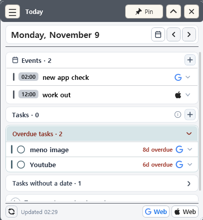
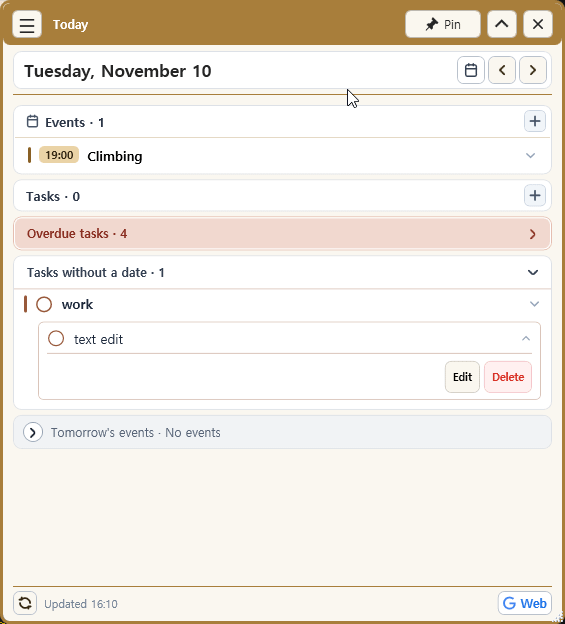
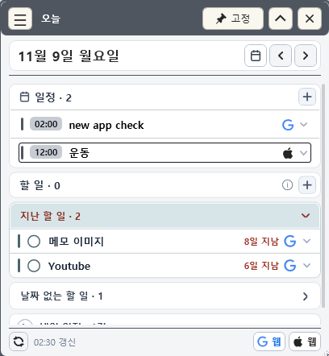
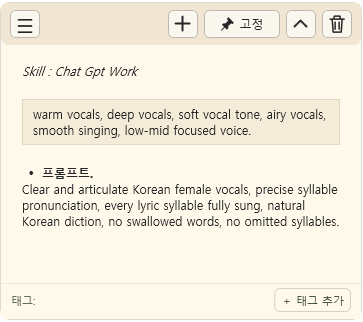
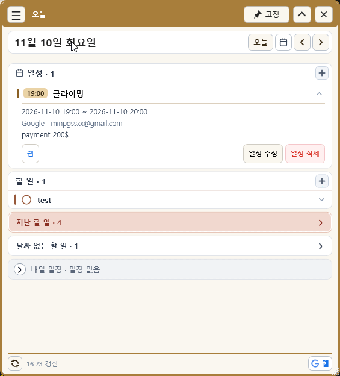
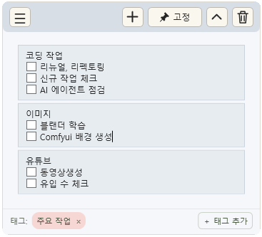
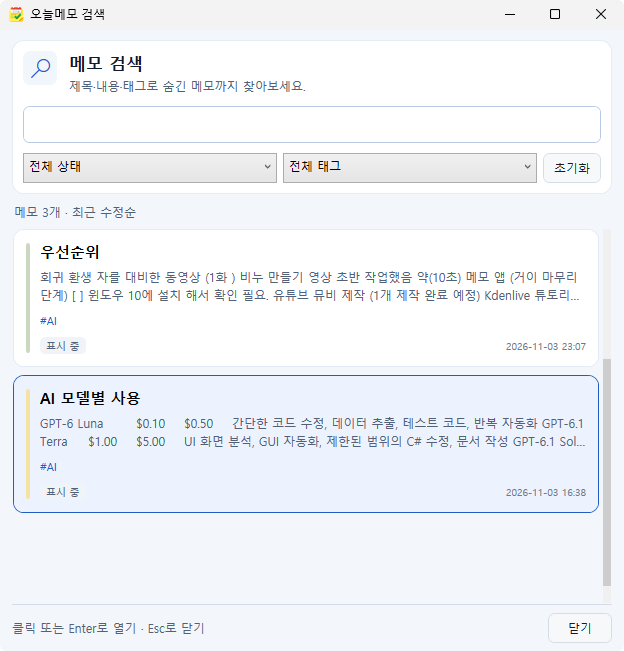
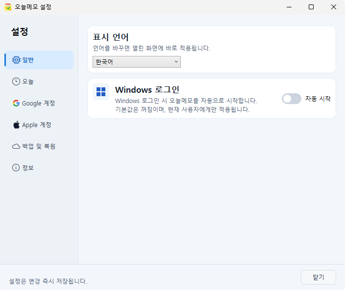

# DayMemo

**English** | [한국어](#오늘메모-daymemo)

**Google Calendar events, tasks and sticky notes on one Windows desktop screen. Optional Google and Apple iCloud sync.**

[**⬇ Download the latest beta**](https://github.com/MinByungGil/daymemo-releases/releases/latest)

> **Community beta.** Planned to be usable until **December 20, 2026 (KST)**; this date may change. Your notes are never deleted when the beta ends.

  

  

I made DayMemo because sticky notes ignore your schedule, desktop calendar widgets are often view-only, and tasks live in yet another app. I wanted my **calendar events always on the desktop, like a note**, and editable right there.

I'm the developer, a solo indie dev. This is a limited beta to check that it works on other people's PCs.
**I have not been able to test on Windows 10.** If you run it on Windows 10, please leave a comment or send feedback about whether it worked.

## Key features

| | |
|---|---|
| **Google Calendar** | View, add, edit and delete events from the Today window. Pick which calendar a new event goes to. |
| **Today window** | Today's events and tasks on one screen. Click a date in the mini calendar to see other days. |
| **Google Tasks** | View, add, edit and complete tasks, including subtasks. |
| **iCloud Calendar** | View, add, edit and delete events. Apple Reminders are view-only. |
| **Desktop notes** | Each note is its own window: snap to other notes and screen edges, checklists, indentation, 8 pastel themes, opacity, always-on-top. |
| **Organize and back up** | Tags and search, trash with restore, ZIP backup and restore. |
| **Other** | English and Korean UI, runs in the system tray. |

Connecting Google or iCloud is **optional**. Notes work fully without connecting anything.

## Where is my data stored?

- Notes are stored **only on your PC** (`%LOCALAPPDATA%\DayMemo`, SQLite). Nothing is uploaded to a server run by the developer.
- There is no app account or sign-up. Google/iCloud sign-in tokens and passwords are encrypted with Windows DPAPI.
- Error reporting is **off by default** and only sent anonymously if you turn it on.
- To check the beta deadline, this beta build reads one public file in this repository (`beta-status.json`). No user information is sent.

## Install

1. Download `DayMemo-community-beta-win-x64.zip` from [Releases](https://github.com/MinByungGil/daymemo-releases/releases/latest).
2. **Extract the whole ZIP**, then run `DayMemo.exe`. Keep all files together.
3. Windows 64-bit only. You do not need to install .NET.
4. The build is not code-signed yet, so Windows may show a "Windows protected your PC" (SmartScreen) warning. Click **More info → Run anyway**. You can compare the download with the SHA256 value shown in the release notes.

## About the beta

- After the deadline, creating and editing notes is limited, but **your notes are not deleted**. You can still view, copy and export a ZIP backup.
- The app shows a notice 7 days before the deadline.
- Final pricing and distribution for the full version have not been decided yet.
- Please send feedback with **"Send bug report / feedback"** inside the app. Even one thing that felt awkward helps a lot.
- Or use the short English feedback form: https://forms.gle/reUVpGnoGwYYHodW6

---

# 오늘메모 (DayMemo)

**바탕화면 메모 + 오늘의 일정·할 일을 한 화면에서 — Windows, Google · Apple iCloud 연동**

[**⬇ 최신 베타 다운로드**](https://github.com/MinByungGil/daymemo-releases/releases/latest)

> **커뮤니티 베타** — **2026년 12월 20일(한국 시간)까지 사용 예정**이며 변경될 수 있습니다. 기간이 끝나도 작성한 메모는 삭제되지 않습니다.

  
  

  

스티커 메모는 일정과 따로 놀고, 바탕화면 캘린더는 보기만 되고, 할 일은 또 다른 앱에서 열어야 해서 앱을 여러 개 켜 두고 쓰는 불편을 줄이려고 만들었습니다.

## 주요 기능

| | |
|---|---|
| **바탕화면 메모** | 메모마다 별도 창, 창끼리·화면 가장자리에 자석처럼 붙기, 체크리스트·들여쓰기, 8가지 색상, 투명도, 항상 위 고정 |
| **오늘 창** | 하루의 일정과 할 일을 한 화면에 표시, 달력에서 날짜를 눌러 다른 날도 확인 |
| **Google · Apple iCloud 연동(선택)** | 일정을 앱에서 추가·수정, Google Tasks는 서브태스크까지 보고 완료 처리. Apple 미리알림은 현재 조회만 가능 |
| **정리와 보관** | 태그와 검색, 휴지통 복구, ZIP 백업·복원 |
| **그 밖에** | 한국어·영어, 시스템 트레이 상주 |

  
  
  

## 내 데이터는 어디에 저장되나요?

- 메모는 **내 PC에만** 저장됩니다(`%LOCALAPPDATA%\DayMemo`). 제가 운영하는 서버로 메모나 일정을 올리지 않습니다.
- 앱 자체 계정은 없고, Google·iCloud 연결은 선택입니다. 로그인 토큰과 암호는 Windows 암호화(DPAPI)로 저장합니다.
- 오류 보고는 **직접 켠 경우에만** 익명으로 전송되며 기본값은 꺼짐입니다.
- 이 베타 빌드는 사용 기한 확인을 위해 이 저장소의 공개 파일(`beta-status.json`) 한 개를 조회합니다. 사용자 정보는 보내지 않습니다.

## 설치

1. [Releases](https://github.com/MinByungGil/daymemo-releases/releases/latest)에서 `DayMemo-community-beta-win-x64.zip`을 받습니다.
2. ZIP을 **모두 풀고** `DayMemo.exe`를 실행합니다. 파일을 함께 두어야 합니다.
3. Windows 64비트 전용이며 .NET은 따로 설치하지 않아도 됩니다. **Windows 10에서는 아직 테스트하지 못했습니다.** Windows 10에서 실행해 보셨다면 동작 여부를 댓글이나 의견으로 알려 주세요.
4. 아직 코드 서명이 없어 Windows가 "PC 보호" 경고를 띄울 수 있습니다. **추가 정보 → 실행**을 누르세요. 받은 파일은 릴리스의 SHA256 값과 비교해 확인할 수 있습니다.

## 테스트 안내

- 기간이 끝나면 새 메모 작성·편집은 제한되지만, **메모는 삭제되지 않고** 조회·복사·백업 내보내기는 계속 가능합니다.
- 기한 7일 전부터 앱 안에서 안내가 표시됩니다.
- 의견은 앱 안의 **"버그 및 의견 보내기"**로 보내 주세요. 불편한 점 한 가지만 알려 주셔도 큰 도움이 됩니다.
